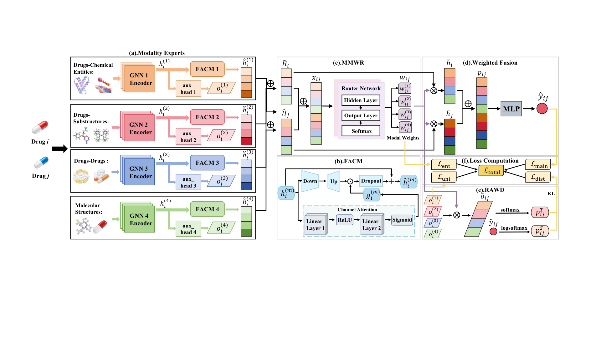

# AARME-GNN
# AARME-GNN

**Adaptive Attention Routing Multimodal Expert Graph Neural Network for Drug-Drug Interaction Prediction**

This repository contains the source code and datasets for the AARME-GNN model, a multimodal knowledge graph-based framework for multi-class drug–drug interaction (DDI) event prediction. The model integrates feature calibration, dynamic modality routing, and distillation to improve prediction accuracy and generalization across known and new drugs.

---

## Framework



---

## Data Files

The `dataset/` folder contains four knowledge graphs in triplet format (<head, relation, tail>) and an SQLite database with drug and interaction event information. Below is a description of each file:

| File | Description |
|------|-------------|
| `dataset1.txt` | Drug–Chemical Entity relations (e.g., drug–transporter, drug–target) extracted from DrugBank. |
| `dataset2.txt` | Drug–Substructure relations, where substructures are derived from drug SMILES strings. |
| `dataset3.txt` | Drug–Drug relations with DDI event types as relation labels (bi‑directional). |
| `dataset4.txt` | Molecular structure relations based on MACCS keys and additional molecular features. |
| `event.db` | SQLite database containing tables `drug` (drug names and IDs) and `extraction` (drug pair interactions with mechanism and action labels). |

**Note:** All data were originally constructed and released by Wu et al. (MKG‑FENN) and are used under the same protocol. The dataset is publicly available at [MKG-FENN GitHub](https://github.com/wudi1989/MKG-FENN). 

---

## Code Files

The `code/` directory contains all Python scripts for model training, evaluation, and the three prediction tasks. Each file is described below:

| File | Description |
|------|-------------|
| `AARME-GNN-task1.py` | Main script for **Task 1**: DDI prediction between known drugs (both drugs seen during training). Implements 5‑fold cross‑validation and saves results. |
| `AARME-GNN-task2.py` | Main script for **Task 2**: DDI prediction between a known drug and a new drug (unseen during training). Uses drug‑similarity‑based neighbor aggregation for new drugs. |
| `AARME-GNN-task3.py` | Main script for **Task 3**: DDI prediction between two new drugs (both unseen). Follows the same protocol as Task 2 but with stricter test splits. |
| `modeltask1.py` | Defines the GNN encoders (GNN1–GNN4), FACM, MMWR, FusionLayer, and auxiliary components for Task 1 (4 modalities). |
| `modeltask2.py` | Defines the same modules but for Task 2, using 3 modalities and adapter‑based feature adaptation. |
| `modeltask3.py` | Defines the modules for Task 3, also with 3 modalities and adaptation for unseen drugs. |

Each model file includes the complete neural network architecture, including the attention adapter, router network, and fusion layer.

---

## Requirements

All dependencies are listed in `requirements.txt`. Core packages include:

- Python 3.7+
- PyTorch 1.8.1 (CPU version used in development; GPU versions should work)
- scikit-learn 0.24.2
- pandas 1.2.4
- numpy 1.19.2
- matplotlib 3.5.3
- scipy 1.6.2


Install with:

```bash
pip install -r requirements.txt
